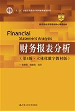

# 书目卡：《财务报表分析》（第5版）
# Book Card: Financial Statement Analysis (5th Edition)

> **性质**：商业出版书，受版权保护。**不下载全文**（无合法免费电子版）。本卡汇总可核实元数据 + 封面 + 正版链接，供学习与采购决策。
> This is a copyrighted commercial book. No full text is downloaded. This card aggregates verified metadata, cover image, and legitimate purchase links.

## 书目信息 / Bibliographic Info

| 项 Item | 内容 Content |
|---|---|
| 书名 Title | 财务报表分析（第5版·立体化数字教材版）Financial Statement Analysis (5th Ed.) |
| 作者 Author | 张新民、钱爱民 / Zhang Xinmin, Qian Aimin |
| 出版社 Publisher | 中国人民大学出版社 / China Renmin University Press |
| 出版时间 Date | 2019-08-16 |
| ISBN | 978-7-300-27162-0 |
| 书号 Book No. | 271620 |
| 定价 Price | ￥49 |
| 荣誉 Awards | 全国优秀教材一等奖；教育部经济管理类核心课程教材；“十二五”国家级规划教材 |
| 课程关联 MOOC | 国家级精品在线开放课程（UIBE），https://www.icourse163.org/course/UIBE-1003252013 |

## 为什么选它 / Why this book

- 作者张新民是"企业财务状况质量分析理论"创立者，本书实现从比率分析 → 财务状况质量分析 → 战略视角分析框架的跨越。**这正好补你的 G3 缺口**（不只会算比率，还要判断数字质量）。
- 阶段一重点章节：第5章利润质量分析、第6章现金流量质量分析、第9章财务比率分析。
- Key chapters for Stage 1: Ch.5 Profit Quality, Ch.6 Cash Flow Quality, Ch.9 Financial Ratio Analysis.

## 获取方式 / How to obtain

- 出版社页面（含样书申请、教学大纲）：http://m.crup.com.cn/Book/detail?doi=8d110f48-4a42-46bf-a9af-ef764dc673ff
- 正版购买：京东/当当/中国人民大学出版社官方店搜索 ISBN `9787300271620`
- 后续版本：第6版 2023-01 ISBN 978-7-300-31078-7；第7版 2026-06 ISBN 978-7-300-35116-2（中国高校教材图书网可查）

## 搭配练习 / Paired exercise

对应 `02-学习沉淀/阶段1-财务报表分析/` 下的实战题：杜邦指标树、三年趋势分析、盈利质量判断（重点用第5、6、9章方法）。
