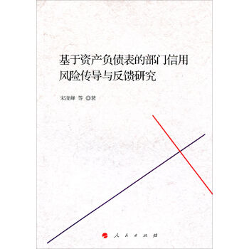

# 书目卡：《财报就像一本故事书》
# Book Card: Financial Statements Are Like a Storybook

> **性质**：商业出版书，受版权保护。**不下载全文**。工程师友好入门书，作为《财务报表分析》的通俗替代/预热读物。
> Copyrighted commercial book. No full text. Engineer-friendly primer — a gentle alternative/warm-up to the heavier textbook.

## 书目信息 / Bibliographic Info

| 项 Item | 内容 Content |
|---|---|
| 书名 Title | 财报就像一本故事书 |
| 作者 Author | 刘顺仁（中国台湾大学会计学系教授）|
| 出版社 Publisher | 山西人民出版社 |
| 出版时间 Date | 2019-04（2018 增订版）|
| ISBN | 9787203107743 |
| 定价 Price | ￥58.00 |
| 中图分类 | F231.5 |
| 版本 history | 2007 初版 ISBN 9787203057857；2018/2019 增订版 ISBN 9787203107743 |

## 目录结构 / Table of Contents（据出版平台“内容提要”）

- **心法篇**：用财报修炼五大神功（破解财富之路的关键密码）
- **招式篇**：损益表、综合损益表、资产负债表、所有者权益变动表、现金流量表五大财务报表
- **进阶篇**：活学活用财务报表，解析企业竞争力，避开商业阴谋

## 为什么适合你 / Why it fits you

- 面向非财会专业读者，叙事式讲法，先用故事建立直觉，再上正式教材（张新民第5版）不突兀。
- 与阶段一"快速轮廓"目标一致：先建立全局感，再深入比率与质量分析。

## 获取方式 / How to obtain

- 出版信息页：https://book.cppinfo.cn/Encyclopedias/home/index?id=4129946
- 正版购买：京东/当当搜索 ISBN `9787203107743`

## 财经英文词汇 / Key English Terms

| 中文 | English |
|---|---|
| 损益表 | Income Statement / Profit & Loss Statement |
| 综合损益表 | Statement of Comprehensive Income |
| 资产负债表 | Balance Sheet / Statement of Financial Position |
| 所有者权益变动表 | Statement of Changes in Equity |
| 现金流量表 | Cash Flow Statement |
| 财务报表 | Financial Statements |
