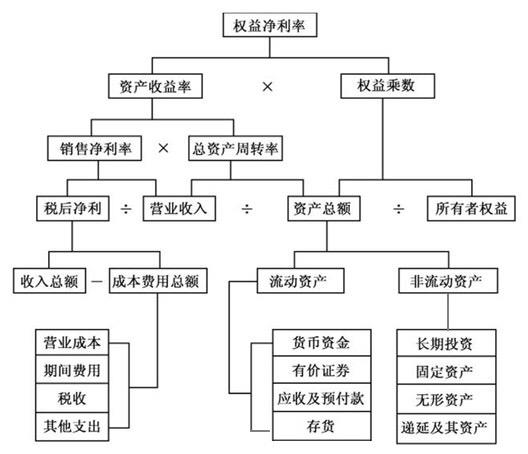

# “杜邦分析体系”，分析财务报表的重要武器
# "The DuPont Analysis System": An Important Tool for Financial Statement Analysis

> **原文来源 / Source**：经济日报新闻客户端，2019-07-10，记者郭子源，责编于浩
> Economic Daily News App, 2019-07-10. Reporter: Guo Ziyuan; Editor: Yu Hao
> **原文链接 / Original URL**：https://static.jingjiribao.cn/static/jjrbrss/3rsshtml/20190710/185823.html
> **排版说明 / Layout**：中文段落在上、英文译文紧随其后，逐段对照。英文为 AI 辅助翻译，供学习财经英语用，非官方译文。
> Chinese paragraph first, followed by its English translation. The English is AI-assisted, for learning financial English only — not an official translation.
> **配图 / Images**：原文 2 张图片均已下载到本地 `assets/`（含杜邦体系结构图）。

---

此前，生财君已经为大家分别讲解了公司财务报表的三大基石——利润表、资产负债表、现金流量表，相信不少小伙伴要问，我们在考察这些报表时，有没有易操作的分析工具呢？今天，生财君就为大家介绍一个重要的财务分析工具——“杜邦分析体系”。

Earlier, we explained the three cornerstones of a company's financial statements — the income statement, the balance sheet, and the cash flow statement. Many of you may be wondering: when examining these statements, is there an easy-to-use analytical tool? Today, we introduce an important financial analysis tool — "the DuPont analysis system."

首先，大家需要了解一个重要的财务指标——净资产收益率（ROE）。

First, you need to understand an important financial metric — Return on Equity (ROE).

净资产收益率（ROE）= 净利润 / 所有者权益，是分析公司盈利能力的核心财务指标之一，其内涵是股东投入资本所创造收益的多少，单位净资产创造的回报越大，表明公司的盈利能力越强。

Return on Equity (ROE) = Net Profit / Shareholders' Equity. It is one of the core financial metrics for analyzing a company's profitability. It captures how much return is generated from the capital invested by shareholders: the greater the return per unit of net assets, the stronger the company's profitability.

“杜邦分析法，则是将企业净资产收益率逐级分解为多项财务比率的乘积，有助于深入分析比较企业经营业绩，是一种从财务角度评价公司盈利能力和股东权益回报水平的经典方法。”中国工商银行私人银行部相关负责人说，这种分析方法最早由美国杜邦公司使用，故名杜邦分析法。

"DuPont analysis decomposes a company's ROE step by step into a product of multiple financial ratios. It helps to analyze and compare business performance in depth, and is a classic method for evaluating a company's profitability and the return on shareholders' equity from a financial perspective," said an official from the Private Banking Department of ICBC. This method was first used by the American company DuPont, hence the name "DuPont analysis."

具体来看，杜邦分析法的核心是将净资产收益率拆分为销售净利率、资产周转率和权益乘数三大部分，分别与公司的经营、投资和筹资活动相对应。

Specifically, the core of DuPont analysis is to break ROE down into three components — net profit margin, asset turnover, and the equity multiplier — corresponding respectively to a company's operating, investing, and financing activities.

用公式来看，

The formula is:

> **净资产收益率（ROE）= 销售净利率 × 资产周转率 × 权益乘数**
> **ROE = Net Profit Margin × Asset Turnover × Equity Multiplier**

其中，销售净利率 = 净利润 / 销售收入，总资产周转率 = 销售收入 / 平均资产总额，权益乘数 = 资产总额 / 所有者权益总额。

Where: Net Profit Margin = Net Profit / Sales Revenue; Total Asset Turnover = Sales Revenue / Average Total Assets; Equity Multiplier = Total Assets / Total Shareholders' Equity.

杜邦分析法说明净资产收益率受三类因素影响：

DuPont analysis shows that ROE is affected by three categories of factors:

（1）盈利能力，用销售净利率衡量；
(1) Profitability, measured by net profit margin;

（2）营运能力，用资产周转率衡量；
(2) Operational efficiency, measured by asset turnover;

（3）财务杠杆，用权益乘数衡量。
(3) Financial leverage, measured by the equity multiplier.

通过下图，我们可以更完整、直观地了解什么是杜邦分析体系。

Through the figure below, we can gain a more complete and intuitive understanding of the DuPont analysis system.

*图：杜邦分析体系分解结构 — 权益净利率 → 资产收益率 × 权益乘数 → 销售净利率 × 总资产周转率 → 税后净利 / 营业收入 / 资产总额 / 所有者权益（原文配图，按原样保留）*
*Figure: DuPont analysis decomposition structure — ROE → ROA × Equity Multiplier → Net Margin × Asset Turnover → ... (original image, preserved as-is)*

*图：原文题图（经济日报）— 保留以完整还原原文*
*Figure: Original header image (Economic Daily) — preserved for completeness*

可以看到，“资产收益率”是影响净资产收益率最重要的指标，具有较强的综合性，而资产收益率取决于销售净利率和总资产周转率的高低。

As can be seen, "Return on Assets (ROA)" is the most important indicator affecting ROE and is highly comprehensive; ROA in turn depends on the net profit margin and total asset turnover.

“销售净利率”反映销售收入的收益水平，扩大销售收入、降低成本费用是提高企业销售利润率的根本途径，而扩大销售同时也是提高资产周转率的必要条件和途径。

"Net profit margin" reflects the level of earnings from sales revenue. Expanding sales revenue and reducing costs and expenses are the fundamental ways to improve a company's sales profit margin; expanding sales is also a necessary condition and a pathway for improving asset turnover.

对于“资产周转率”，我们可以对影响资产周转的各因素进行进一步分析，以判断公司运营情况是否良好。

For "asset turnover," we can further analyze the various factors that affect asset turnover to judge whether the company is operating well.

影响净资产收益率的另一重要指标为“权益乘数”，它反映的是公司利用财务杠杆进行经营活动的程度，即企业的负债程度。资产负债率越高，权益乘数就越大，表明公司负债程度高，公司会有较高的杠杆利益，但相应承担的风险也就越高；反之，资产负债率越低，权益乘数越小，企业杠杆利益较低，相应所承担的风险也越低。

Another important indicator affecting ROE is the "equity multiplier," which reflects the extent to which a company uses financial leverage in its operations — in other words, its degree of indebtedness. The higher the debt-to-asset ratio, the larger the equity multiplier, indicating a high level of debt; the company will enjoy greater leverage benefits but will also bear correspondingly higher risk. Conversely, the lower the debt-to-asset ratio, the smaller the equity multiplier, with lower leverage benefits and correspondingly lower risk.

值得注意的是，杜邦分析体系也并非完美无缺，它也存在自身的局限性。

It is worth noting that the DuPont analysis system is not without flaws; it has its own limitations.

具体来看，由于杜邦分析法主要运用的是公司财务方面的信息，因此在考察企业整体实力方面具有较大的局限性，在实际运用中，需结合企业的其他信息加以权衡，主要体现以下三点。

Specifically, because DuPont analysis mainly uses a company's financial information, it has considerable limitations in assessing the overall strength of an enterprise. In practice, it needs to be weighed together with other information about the company, mainly reflected in the following three points.

（1）杜邦分析体系中应用的财务指标主要反映的是企业过去的经营业绩，而无法反映企业在产品创新、企业管理等方面的情况。

(1) The financial indicators used in the DuPont system mainly reflect a company's past operating performance, and cannot reflect its situation in areas such as product innovation and corporate management.

（2）运用杜邦分析法对 ROE 分析，体现的是企业短期一年的财务收益情况，而没有体现长期投资对于公司长期盈利能力的促进作用，如果公司的长期投资需要在一段较长时间内体现经济价值，则无法反映在当期的 ROE 上。

(2) Analyzing ROE with the DuPont method reflects a company's short-term, one-year financial returns, but does not capture the contribution of long-term investment to the company's long-term profitability. If a long-term investment needs a relatively long period to realize its economic value, it cannot be reflected in the current period's ROE.

（3）对 ROE 的分析无法充分反映公司所承担的风险。ROE 作为一个结果性的指标，无法衡量公司在获得财务回报的过程中所承担的现实风险和潜在风险，而这些风险会直接影响企业发展的可持续性，进而影响对企业价值的评估。

(3) The analysis of ROE cannot fully reflect the risks a company bears. As an outcome-based indicator, ROE cannot measure the actual and potential risks a company undertakes in the process of generating financial returns. These risks directly affect the sustainability of the company's development and, in turn, affect the valuation of the enterprise.

综上所述，杜邦分析法是用来评价企业盈利能力和股东权益回报水平，从财务角度评价企业绩效的一种有效方法，能较为清晰地展示企业经营、投资和筹资活动的情况，但由于杜邦分析法仅运用了企业的财务信息，具有一定的局限性，在实际运用中，需结合企业的其他信息加以权衡。

In summary, DuPont analysis is an effective method for evaluating a company's profitability and the level of return on shareholders' equity, and for assessing corporate performance from a financial perspective. It can clearly demonstrate a company's operating, investing, and financing activities. However, because it uses only financial information, it has certain limitations; in practice, it needs to be weighed together with other information about the company.

（经济日报 记者：郭子源 责编：于浩）
(Economic Daily, Reporter: Guo Ziyuan; Editor: Yu Hao)

---

## 财经术语中英对照表 / Financial Terms Glossary (CN–EN)

| 中文 Chinese | 英文 English | 缩写 Abbr. |
|---|---|---|
| 净资产收益率 / 权益净利率 | Return on Equity | ROE |
| 资产收益率 | Return on Assets | ROA |
| 净利润 | Net Profit / Net Income | — |
| 所有者权益 / 股东权益 | Shareholders' Equity / Owners' Equity | — |
| 销售净利率 | Net Profit Margin | — |
| 资产周转率 / 总资产周转率 | (Total) Asset Turnover | — |
| 权益乘数 | Equity Multiplier | — |
| 销售收入 | Sales Revenue | — |
| 销售成本 | Cost of Goods Sold | COGS |
| 期间费用 | Period Expenses | — |
| 利润总额 | Total Profit | — |
| 所得税 | Income Tax | — |
| 流动资产 | Current Assets | — |
| 非流动资产 | Non-current Assets | — |
| 资产负债率 | Debt-to-Asset Ratio | — |
| 财务杠杆 | Financial Leverage | — |
| 权益变动 / 净资产 | Net Assets | — |
| 盈利能力 | Profitability | — |
| 营运能力 | Operational Efficiency | — |
| 短期偿债能力 | Short-term Solvency | — |
| 现金流 | Cash Flow | — |

## 学习提示 / Study Notes

- 杜邦分解在工程上就是一棵**指标树**：ROE 为根，三层分解。这正好呼应你的建模思维——可把每个因子对应到一个可计算的度量（metric）。
  DuPont decomposition is essentially a **metric tree** in engineering terms: ROE at the root, decomposed in layers — matching a modeling mindset where each factor maps to a computable metric.
- 原文图2（已保留）展示了完整分解路径，可作为你设计"多维指标立方体"的字段层级参考。
  The preserved Figure 2 shows the full decomposition path and can serve as a reference for field hierarchies when designing a multidimensional metric cube.
